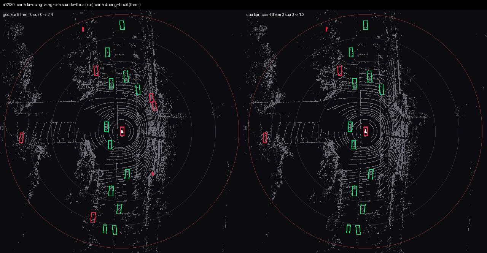

# Báo cáo Day 14 — Phạm Trần Anh — 2A202604057

- Mã học viên dùng với `--student`: `2A202604057`
- `seed_tag` trong `frames_A.txt`: `82ac3100fd`

## 1. Dự đoán trước sweep (bước 5b)

Ghi **trước** khi chạy `scripts/pp_sweep.py`, rồi commit và push ngay (lịch sử commit là bằng chứng thời điểm viết). Không sửa phần này sau khi có kết quả.

| Frame | Hộp dự đoán gốc | Hộp sau khi sửa trên CVAT |
|---|---:|---:|
| `s02f30` | 20 | 13 |
| `s03f09` | 22 | 12 |
| `s05f45` | 17 | 16 |

- Tham số tôi dự đoán sẽ giảm công sửa nhiều nhất: Tăng `min_points`.
- Lý do: Khi sửa tập A, tôi thấy phần lớn các hộp phải xóa bao nhầm vật và chỉ chứa ít điểm LiDAR. Tôi dự đoán tăng số điểm tối thiểu cần có trong mỗi hộp sẽ lọc bớt các hộp thừa này, nhờ đó giảm số hộp phải xóa thủ công.

## 2. Tập A: sửa tay và tune

Sau bước 5b, tập A được rà lại và xuất lại từ CVAT. Bản dùng để sweep có 12 hộp ở s02f30, 12 ở s03f09 và 15 ở s05f45.

| Cấu hình | Xóa | Thêm | Sửa | Chi phí |
|---|---:|---:|---:|---:|
| Gốc | 25 | 5 | 4 | 14.5 |
| `best_config.json` | 18 | 5 | 4 | 12.4 |

- Tham số đã đổi trong `best_config.json`: `score_thr` tăng từ 0,1 lên 0,3. `min_points` giữ ở 0.
- Kết quả leave-one-out (cấu hình chọn trên hai frame còn lại, chi phí trên frame giữ lại và mức thấp nhất có thể):
  - s02f30 — score_thr=0.3, min_points=10 → 2,2 (thấp nhất 1,2).
  - s03f09 — score_thr=0.3, min_points=0 → 4,7 (thấp nhất 4,4).
  - s05f45 — score_thr=0.3, min_points=0 → 6,5 (thấp nhất 6,5).
Cả ba lượt leave-one-out đều chọn cùng ngưỡng điểm 0,3. Ngưỡng số điểm LiDAR thay đổi theo frame giữ lại. Trên toàn tập A, cấu hình dùng cho tập B đạt chi phí 12,4, thấp nhất trong 15 tổ hợp đã thử và đồng hạng với cấu hình có min_points=5.

## 3. Trước/sau (bước 8)

- `scripts/pp_compare.py` báo giảm 14% chi phí sửa (từ 14,5 xuống 12,4) trên tập A.
Ở frame minh họa s02f30, chi phí giảm từ 2,4 xuống 1,2. Trên toàn tập A, khi giữ score_thr=0.3, hai mức min_points=0 và 5 đều cho 18 hộp cần xóa, 5 hộp cần thêm và 4 hộp cần sửa. Ở mức min_points=10, các số tương ứng là 17, 6 và 4. Chi phí tăng từ 12,4 lên 13,1 vì thêm một hộp có trọng số 1,0 còn xóa một hộp có trọng số 0,3.

Kết quả trên ba frame tập A chưa ủng hộ dự đoán ở mục 1. Mức giảm chi phí từ 14,5 xuống 12,4 đạt được khi tăng `score_thr` từ 0,1 lên 0,3 và giữ `min_points` ở 0. Tăng thêm `min_points` lên 5 hoặc 10 đều không giúp giảm chi phí hơn nữa.

## 4. Tập B

Số đo từ `scripts/pp_prelabel.py --frames d14_2A202604057/frames_B.txt --config d14_2A202604057/best_config.json --gt d14_2A202604057/ref_B.json`:

| Xóa | Thêm | Sửa | Chi phí |
|---:|---:|---:|---:|
| 146 | 6 | 9 | 54,3 |

- Hộp dự đoán thừa chiếm phần chi phí lớn nhất. Có 146 hộp cần xóa, tương ứng 43,8 điểm trên tổng 54,3 điểm chi phí sửa.

## 5. Giới hạn

Tập A chỉ có ba frame. Chẳng hạn, khi giữ lại s02f30, cấu hình chọn từ hai frame còn lại đạt chi phí 2,2 trên s02f30, trong khi mức thấp nhất quan sát được ở frame này là 1,2. Vì vậy, mức giảm 14% trên A chưa cho biết cấu hình sẽ giảm bao nhiêu chi phí trên một tập mới.

Chi phí được tính bằng 0,3 × số hộp xóa + số hộp thêm + 0,5 × số hộp sửa. Bài thực hành không đo thời gian thao tác từng hộp trên CVAT, nên chưa thể quy đổi 54,3 điểm ở tập B thành phút hoặc giờ làm việc.
